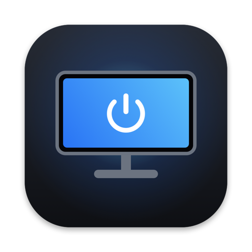
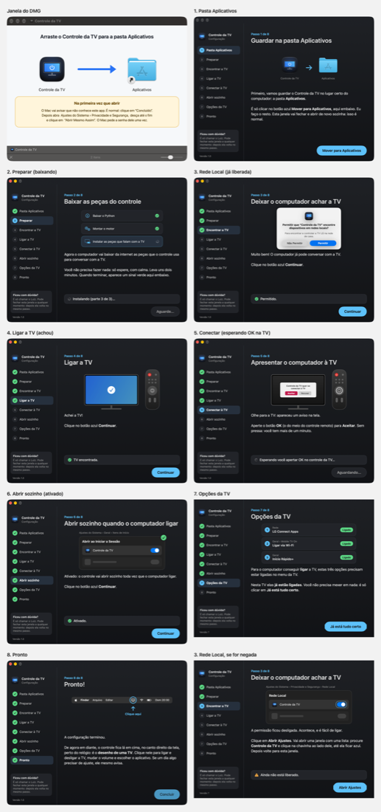
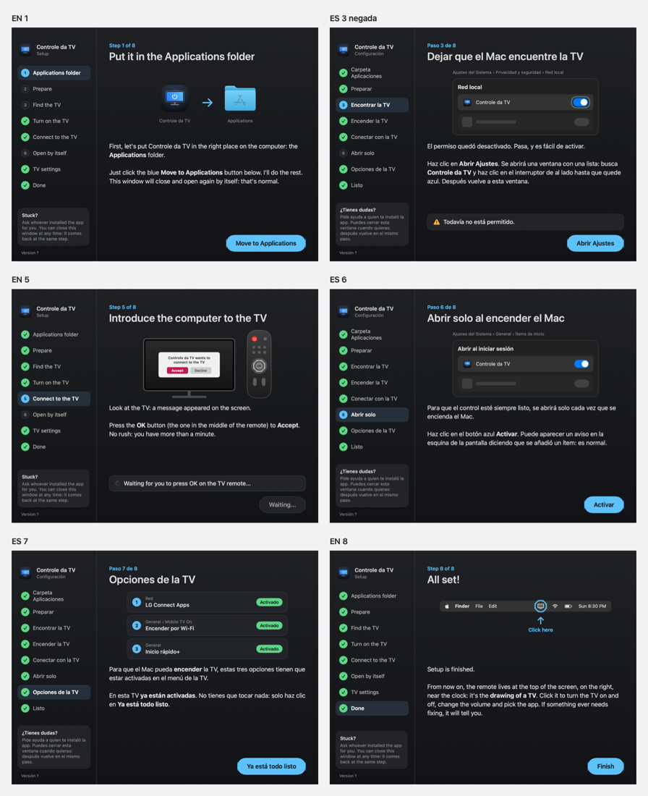

<p align="center"></p>

<h1 align="center">Controle da TV</h1>

<p align="center">
Controle remoto da TV LG (webOS) na barra de menus do Mac · Remote control for LG webOS TVs in the Mac menu bar · Control remoto de la TV LG (webOS) en la barra de menús del Mac
</p>

<p align="center">
<a href="#português">Português</a> · <a href="#english">English</a> · <a href="#español">Español</a> · <a href="https://tv.didek.com.br">tv.didek.com.br</a>
</p>

> **Sem vínculo com a LG · Not affiliated with LG · Sin vínculo con LG.** Projeto independente e de código aberto. "LG" e "webOS" são marcas da LG Electronics Inc.; as demais marcas pertencem aos seus donos. Veja os [Termos de Uso](TERMOS.md).



---

## Português

### O que é

Um app pequeno para Mac que transforma o computador num controle remoto da TV LG da casa. Ele fica na barra de menus, perto do relógio, e conversa com a TV pela rede Wi-Fi de casa: sem cabos, sem conta e sem nuvem. Foi feito para uma pessoa idosa e pouco acostumada com tecnologia, então a primeira configuração é um assistente com desenhos, um passo por tela, e depois o app se atualiza sozinho.

O app, a página do celular e o site estão em **português, inglês e espanhol** (seguem o idioma do aparelho).

### O que faz

- Liga e desliga a TV (Wake-on-LAN).
- Volume e mudo, troca de entrada (HDMI, TV ao vivo), setas, OK, Voltar e Início.
- Abre os apps da TV (Netflix, YouTube, Globoplay, Prime Video, Disney+…).
- Busca no YouTube pelo teclado do Mac e abre o vídeo direto na TV.
- Página de controle para o celular, no navegador de qualquer aparelho da mesma rede.
- Assistente de primeira configuração: pasta Aplicativos, componentes, permissão de Rede Local, pareamento com a TV e abrir ao iniciar. Se faltar alguma permissão depois, ele avisa e reabre no passo certo.
- Atualização automática assinada.

### TVs compatíveis

TVs LG com **webOS** (em geral, as smart TVs da LG desde 2014). Feito e testado com a **LG 50UK6510PSF** (2018, webOS 4.4). Para ligar a TV pela rede, ative no menu da TV: *Rede › LG Connect Apps*, *Geral › Mobile TV On › Ligar via Wi-Fi* e *Geral › Início Rápido+*.

### Instalar

Baixe o DMG em **https://tv.didek.com.br** e siga o passo a passo da página, ou, no Terminal:

```bash
curl -fsSL https://tv.didek.com.br/instalar.sh | bash
```

Requisitos: Mac com chip Apple (M1 ou mais novo), macOS 14 ou mais novo, Mac e TV na mesma rede.

### Como funciona

| Parte | O que faz |
|---|---|
| `macos/` | App SwiftUI de barra de menus (painel, assistente, atualizador). Compila só com as Command Line Tools, sem Xcode. |
| `servidor/` | Servidor local em Python (aiohttp, porta 8765) que fala com a TV pelo protocolo SSAP do webOS ([aiowebostv](https://github.com/home-assistant-libs/aiowebostv)), liga a TV por Wake-on-LAN, procura a TV por mDNS/SSDP, faz as buscas no YouTube ([yt-dlp](https://github.com/yt-dlp/yt-dlp)) e serve a página do celular. |
| motor | O [uv](https://github.com/astral-sh/uv) vai dentro do app; na primeira abertura ele baixa o Python 3.13 e as bibliotecas para `~/Library/Application Support/Controle da TV/`. |
| `site/` | Página de download, termos de uso e instalador por Terminal. |
| `ferramentas/` | Ícone e fundo do DMG (desenhados em código), assinatura Ed25519, certificado, DMG, conferência de traduções. |

A chave de pareamento com a TV fica só no Mac (arquivo com permissão 600) e nunca vai para o navegador.

**Atualização segura:** o app só instala uma versão nova se (1) o `versao.json` tiver assinatura Ed25519 válida, (2) o zip tiver o sha256 anunciado e (3) o app novo estiver assinado com o mesmo certificado e identificador. Como o certificado é estável, o macOS mantém as permissões (Rede Local, abrir ao iniciar) a cada atualização.

### Compilar

Precisa de macOS 14+ em Apple Silicon, Command Line Tools (`xcode-select --install`) e uv (`brew install uv`).

```bash
cp publicar.conf.exemplo publicar.conf   # opcional: identificador, frase de ajuda, site
./build.sh                               # gera build/Controle da TV.app
```

Na primeira vez, o `build.sh` cria um certificado de assinatura próprio num keychain separado, na pasta `SEGREDOS` (fora do repositório). Sem `SITE` no `publicar.conf`, o app compilado não procura atualizações.

### Publicar a sua própria distribuição

Preencha `SITE`, `CLOUDFLARE_CONTA` e `WORKER` no `publicar.conf`, faça login no [wrangler](https://developers.cloudflare.com/workers/wrangler/) e rode:

```bash
./publicar.sh 1.0.0 "o que mudou"
```

O script sobe a versão, compila, assina, gera zip, DMG, `versao.json` assinado, site e termos, e publica num Worker da Cloudflare com domínio próprio. **Guarde a pasta `SEGREDOS` em lugar seguro**: sem o certificado e a chave Ed25519, os apps já instalados não aceitam mais as suas atualizações.

### Licença e termos

Código sob a [licença MIT](LICENSE). Uso sujeito aos [Termos de Uso](TERMOS.md): sem garantia, sem vínculo com a LG ou com outras marcas, sem coleta de dados.

Créditos: [aiowebostv](https://github.com/home-assistant-libs/aiowebostv), [aiohttp](https://github.com/aio-libs/aiohttp), [yt-dlp](https://github.com/yt-dlp/yt-dlp), [uv](https://github.com/astral-sh/uv), [dmgbuild](https://github.com/dmgbuild/dmgbuild). Paleta do painel inspirada no controle de ar-condicionado de [@YuriRDev](https://github.com/YuriRDev).

---

## English

### What it is

A small Mac app that turns your computer into a remote control for the LG TV at home. It lives in the menu bar, next to the clock, and talks to the TV over your home Wi-Fi: no cables, no account and no cloud. It was made for an elderly person who isn't comfortable with technology, so the first setup is a step-by-step assistant with drawings, one step per screen, and afterwards the app updates itself.

The app, the phone page and the website are available in **Portuguese, English and Spanish** (they follow the device language).



### What it does

- Turns the TV on and off (Wake-on-LAN).
- Volume and mute, input switching (HDMI, live TV), arrows, OK, Back and Home.
- Opens TV apps (Netflix, YouTube, Prime Video, Disney+…).
- Searches YouTube with the Mac keyboard and opens the video right on the TV.
- Remote control page for your phone, in the browser of any device on the same network.
- First-run setup assistant: Applications folder, components, Local Network permission, TV pairing and open at login. If a permission goes missing later, it tells you and reopens at the right step.
- Signed automatic updates.

### Compatible TVs

LG TVs running **webOS** (generally LG smart TVs from 2014 onward). Built and tested with the **LG 50UK6510PSF** (2018, webOS 4.4). To turn the TV on over the network, enable in the TV menu: *Network › LG Connect Apps*, *General › Mobile TV On › Turn on via Wi-Fi* and *General › Quick Start+*.

### Install

Download the DMG at **https://tv.didek.com.br** and follow the steps on the page, or in Terminal:

```bash
curl -fsSL https://tv.didek.com.br/instalar.sh | bash
```

Requirements: a Mac with Apple silicon (M1 or newer), macOS 14 or newer, Mac and TV on the same network.

### How it works

- `macos/`: SwiftUI menu bar app (panel, setup assistant, updater). Builds with the Command Line Tools only, no Xcode.
- `servidor/`: local Python server (aiohttp, port 8765) that talks to the TV over webOS SSAP ([aiowebostv](https://github.com/home-assistant-libs/aiowebostv)), wakes it with Wake-on-LAN, finds it via mDNS/SSDP, runs YouTube searches ([yt-dlp](https://github.com/yt-dlp/yt-dlp)) and serves the phone page.
- Engine: [uv](https://github.com/astral-sh/uv) ships inside the app; on first launch it downloads Python 3.13 and the libraries into `~/Library/Application Support/Controle da TV/`.
- `site/`: download page, terms of use and Terminal installer. `ferramentas/`: icon and DMG background (drawn in code), Ed25519 signing, certificate, DMG and translation checks.

The TV pairing key stays on the Mac (file mode 600) and never reaches the browser. An update is installed only if the `versao.json` Ed25519 signature is valid, the zip matches the announced sha256 and the new app is signed with the same certificate and identifier.

### Build

Requires macOS 14+ on Apple silicon, the Command Line Tools (`xcode-select --install`) and uv (`brew install uv`).

```bash
cp publicar.conf.exemplo publicar.conf   # optional: bundle id, help sentence, site
./build.sh                               # creates build/Controle da TV.app
```

To run your own distribution, set `SITE`, `CLOUDFLARE_CONTA` and `WORKER` in `publicar.conf`, log in to [wrangler](https://developers.cloudflare.com/workers/wrangler/) and run `./publicar.sh 1.0.0 "what changed"`. Keep the `SEGREDOS` folder safe: without the certificate and the Ed25519 key, installed apps will no longer accept your updates.

### License and terms

Code under the [MIT License](LICENSE). Use is subject to the [Terms of Use](TERMOS.md): no warranty, no affiliation with LG or other brands, no data collection.

---

## Español

### Qué es

Una pequeña app para Mac que convierte la computadora en un control remoto de la TV LG de la casa. Vive en la barra de menús, junto al reloj, y habla con la TV por el Wi-Fi de casa: sin cables, sin cuenta y sin nube. Se hizo para una persona mayor y poco acostumbrada a la tecnología, así que la primera configuración es un asistente con dibujos, un paso por pantalla, y después la app se actualiza sola.

La app, la página del teléfono y el sitio están en **portugués, inglés y español** (siguen el idioma del aparato).

### Qué hace

- Enciende y apaga la TV (Wake-on-LAN).
- Volumen y silencio, cambio de entrada (HDMI, TV en vivo), flechas, OK, Atrás e Inicio.
- Abre las apps de la TV (Netflix, YouTube, Prime Video, Disney+…).
- Busca en YouTube con el teclado del Mac y abre el video directo en la TV.
- Página de control para el teléfono, en el navegador de cualquier aparato de la misma red.
- Asistente de primera configuración y actualización automática firmada.

### TVs compatibles

TVs LG con **webOS** (en general, las smart TV de LG desde 2014). Hecho y probado con la **LG 50UK6510PSF** (2018, webOS 4.4). Para encender la TV por la red, activa en el menú de la TV: *Red › LG Connect Apps*, *General › Mobile TV On › Encender por Wi-Fi* y *General › Inicio rápido+*.

### Instalar

Descarga el DMG en **https://tv.didek.com.br** y sigue los pasos de la página, o en la Terminal:

```bash
curl -fsSL https://tv.didek.com.br/instalar.sh | bash
```

Requisitos: Mac con chip de Apple (M1 o más nuevo), macOS 14 o más nuevo, Mac y TV en la misma red.

### Compilar y publicar

Requiere macOS 14+ en Apple silicon, las Command Line Tools y uv. `./build.sh` genera `build/Controle da TV.app`; `./publicar.sh 1.0.0 "qué cambió"` publica tu propia distribución (configura `publicar.conf` a partir de `publicar.conf.exemplo`). Guarda la carpeta `SEGREDOS` en un lugar seguro.

### Licencia y términos

Código bajo la [licencia MIT](LICENSE). El uso está sujeto a los [Términos de uso](TERMOS.md): sin garantía, sin vínculo con LG ni con otras marcas, sin recolección de datos.
